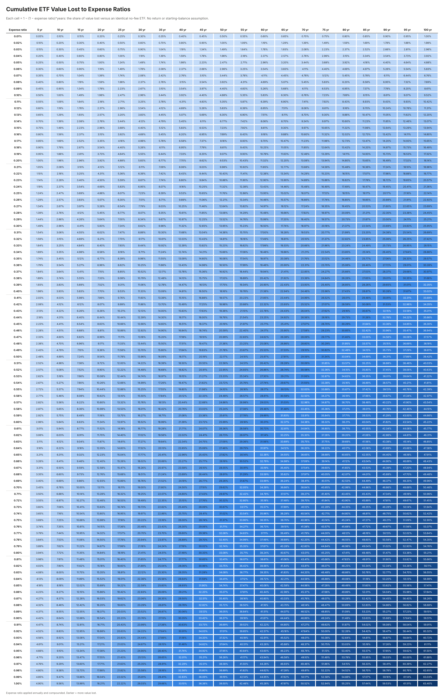

# ETF Fee Bite Table

This repository contains a complete table showing the cumulative percentage of an ETF's value consumed by its expense ratio over time.



## Coverage

- Expense ratios: 0.01% through 1.00%, in 0.01% increments
- Time periods: 5 through 100 years, in 5-year increments
- Formats: Excel (`.xlsx`), CSV (`.csv`), and a shaded PNG image (`.png`, regenerate with `python3 render_png.py`; requires matplotlib)

## Calculation

```text
cumulative fee bite = 1 - (1 - expense ratio)^years
```

Each result is the percentage of value lost relative to an otherwise identical no-fee ETF. The calculation assumes the expense ratio is applied annually and compounds over time; it does not require an investment-return or starting-balance assumption.
